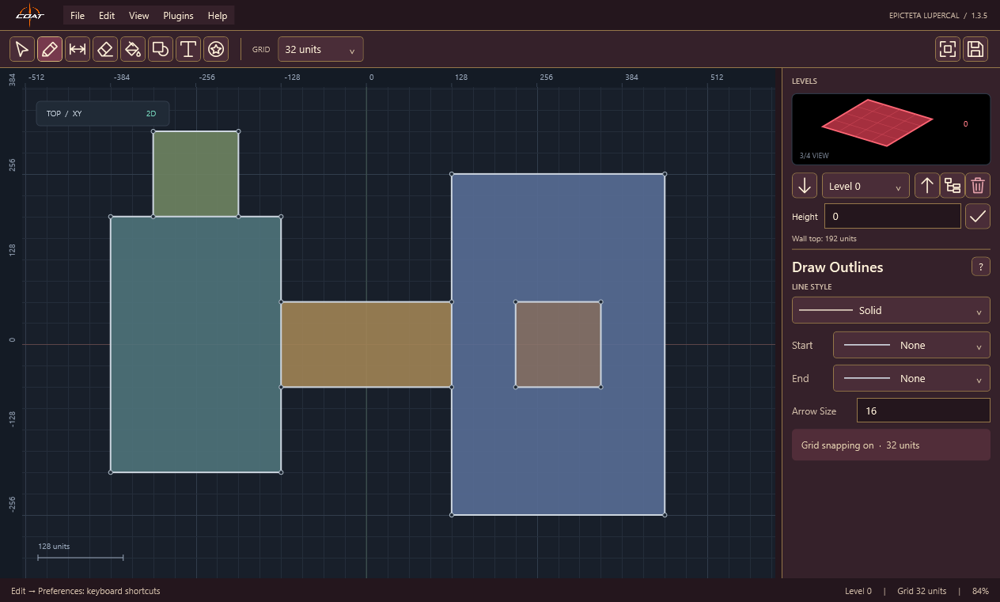

[**Download Coat for Windows x64 · published build 1.1.0**](https://raw.githubusercontent.com/EpictetaLupercal/Coat/main/Coat-1.1.0-Windows-x64.zip)

# Coat

Coat is a 2D level design editor by Epicteta Lupercal. Sketch a floor plan on a snapping grid, organize rooms across levels, and annotate routes with dimensions, text and tokens. Export the plan as a PNG or SVG, or turn filled shapes into editable floor and wall brushes in a Valve 220 `.map` file.

Extract the Windows ZIP, keep its files together and run **Coat.exe**. The application requires the [.NET 8 Desktop Runtime for Windows x64](https://dotnet.microsoft.com/en-us/download/dotnet/8.0).

## Release highlights

**1.5 → 1.6** · The foldable minimap moves the camera by click or drag, and pings can be pinned as persistent markers. The viewport HUD adds contextual commands and project-specific XP with export and playtest quests.

**1.2 → 1.3** · The compact toolbar uses icons for drawing, dimensioning, erasing and other tools. Hover over a command for its name and hold **Shift** for details. Resize the inspector by dragging its left edge. With a selection, S, R and T activate Scale, Rotate and Move. Choose **Bordeaux** in **Edit → Preferences → Appearance** for burgundy panels, ivory lettering and brass borders. Since **1.3.2**, the Plugins menu can discover, show and run Lua extensions. [Lua plugin guide](docs/LUA-PLUGINS.md)

**1.1 → 1.2** · Nested contours support holes, and convex shapes keep a single brush when exported. Different fill colors preserve separate geometry, including pillars inside a floor. Dimension lines, independent arrowheads, symbol tokens, a live color picker, and individual selection inside groups make plans easier to draw and edit. Text and tokens can move with geometry in a marquee selection.

[English user guide](docs/README-English.md) · [Guide français](docs/Guide-Francais.md) · [Full release notes](docs/CHANGELOG-English.md)

To build the current source on Windows x64, install the .NET 8 SDK and run `./build.ps1`. Run `./test.ps1` for regression checks.
